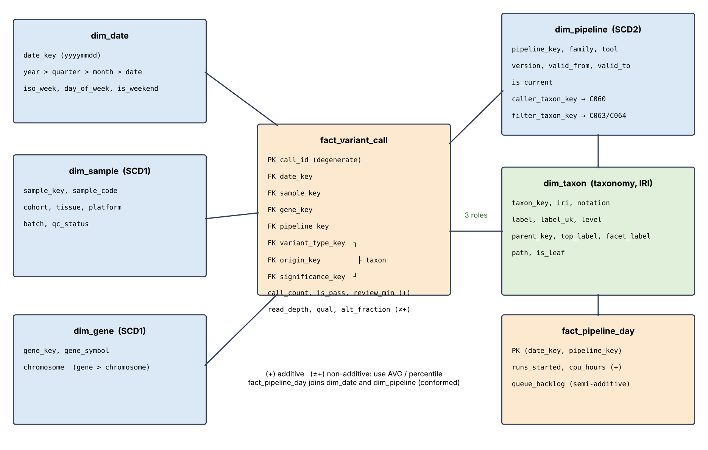

# Star schema design (R1)

DDL: `sql/ddl.sql` (executed by `etl/load.py`). Diagram: `docs/star_schema.png`.

## Business process and grain
**Process:** variant calling in a genomics lab (hereditary-cancer panel genes): a sample is sequenced, a pipeline (GATK, bcftools, Strelka2, DeepVariant) calls variants, a filter marks each call pass/fail, an analyst reviews the interesting ones.

**Grain of `fact_variant_call`: one called variant (one `call_id`) of one sample, in one gene, produced by one pipeline version on one date.** Fixing the grain first decides which dimensions are possible (everything that has a single value per call), which measures are additive, and what a `COUNT(*)` means (one call). A second fact, **`fact_pipeline_day`**, has the grain *one pipeline version in effect on one calendar day* (periodic snapshot of the compute queue).

## Business questions (≥5)
Candidate questions were proposed by an LLM (`llm_log/raw/bq_out.json`, prompt `bq_v1`); I checked each against the schema and chose the ones below (decision in the last column).

| id | question | OLAP operation | decision → query |
|---|---|---|---|
| BQ01 | How many calls passed in each gene and what share is that of the chromosome / total? | rollup | accepted → q02 |
| BQ02 | How do call counts and the pass rate change by year and quarter? | rollup | accepted → q01 |
| BQ04 | How are clinical-significance classes distributed across variant types? | pivot | accepted → q07 |
| BQ05 | Which samples consumed the most review minutes within each QC group? | window rank | accepted → q09 |
| BQ06 | Did tool-version upgrades change average quality / depth? | group by SCD2 | accepted → q13 |
| BQ08 | CPU hours and queue backlog per month | semi-additive | accepted, changed to the all-family daily total → q14 |
| BQ09 | Which cohort × tissue combinations have the highest pass share? | dice / cube | accepted, implemented as CUBE → q03 |
| BQ10 | Call counts by taxonomy level (top → facet → concept) | drill-down | accepted, operation changed from *cube* to *rollup* (it is a hierarchy) → q11, q12 |
| BQ11 | Weekend vs weekday review time | slice | accepted, sliced to 2026 → q05 |
| BQ03, BQ07, BQ12 | germline/somatic per chromosome; QoQ allele fraction per platform; share of runs per family per quarter | pivot/window | **not used**: covered by q07 / q10 / q08; the LLM's BQ12 would repeat q08 |

## Dimensions (6, one of them the taxonomy)
| dimension | key | attributes | hierarchy | SCD |
|---|---|---|---|---|
| `dim_date` | date_key (yyyymmdd) | year, quarter, month, week, weekday, is_weekend | date → month → quarter → year | – (static) |
| **`dim_taxon`** | taxon_key, **iri**, notation | label, label_uk, level, parent_key, top_label, facet_label, path, is_leaf | concept → facet → top class (SKOS `broader` from Lab 5; 154 concepts) | versioned by taxonomy release (see below) |
| `dim_sample` | sample_key, sample_code | cohort, tissue, platform, batch, qc_status | – | **type 1** |
| `dim_gene` | gene_key, gene_symbol | chromosome | gene → chromosome | **type 1** |
| `dim_pipeline` | pipeline_key (surrogate per version) | family, tool, version, valid_from/valid_to, is_current, caller_taxon_key, filter_taxon_key | version → family | **type 2** |

### How the taxonomy is used as a dimension
`dim_taxon` is loaded from `taxonomy_final.csv` of Lab 5 (one row per concept; `iri` = `http://example.org/knowledge-hub/biomed/C0xx`, identical to the SKOS file `data/raw/taxonomy.ttl`). It is a **role-playing dimension**: `fact_variant_call` has three foreign keys to it – `variant_type_key` (branch *genetic variant*: SNP, indel, SV, CNV), `origin_key` (*Variant by origin*: germline / somatic) and `significance_key` (*Variant by clinical significance*: pathogenic / benign / VUS). `dim_pipeline` uses it twice (`caller_taxon_key` = *variant calling* C060, `filter_taxon_key` = *hard filtering* C063 or *variant quality score recalibration* C064). The columns `top_label` and `facet_label` are the pre-computed ancestors, so roll-up and drill-down are plain `GROUP BY` without recursive queries (q11, q12, q15). Load-time check: each role must point into its own branch (`taxon_role_*` checks in `docs/dq_report.json`).

### SCD policy
- **Type 2 – `dim_pipeline`:** a tool upgrade creates a new row (`valid_from`/`valid_to`), a call is linked to the version valid on its date. This keeps history truthful (GATK 4.4 → 4.5 → 4.6 differ in quality, q13). Checks: no overlapping intervals and exactly one current row per family.
- **Type 1 – `dim_sample`, `dim_gene`:** corrections (e.g. a changed QC status) overwrite the attribute; history of these attributes is not analysed.
- **Taxonomy:** a new taxonomy release is loaded as a new version of `dim_taxon` (concept IRI stays the key; changed labels = type 1, moved concepts = a new row with new `parent_key` and a dataset version bump). Only one release (Lab 5, v1) is loaded now – this is a stated limitation.

## Measures
| measure | table | class | how to aggregate |
|---|---|---|---|
| `call_count` (=1) | fact_variant_call | additive | SUM |
| `is_pass` (0/1) | fact_variant_call | additive | SUM = passed calls; pass rate = SUM/COUNT |
| `review_minutes` | fact_variant_call | additive | SUM |
| `read_depth`, `qual`, `alt_fraction` | fact_variant_call | **non-additive** | AVG / percentile over calls (never SUM; never average of averages) |
| `runs_started`, `cpu_hours` | fact_pipeline_day | additive | SUM |
| `queue_backlog` | fact_pipeline_day | **semi-additive** | SUM across pipelines on one day, AVG/last across days |

## Data generator (documented synthetic data)
`etl/generate.py`, seed 42. 20 000 calls (+5 deliberately defective rows) between 2025-01-01 and 2026-09-30, 300 samples, 10 genes with their real chromosomes, 8 pipeline versions, daily snapshot of 4 families (2 552 rows). Invented distributions: volume ramps up over time; variant type 80/13/4/3 % (SNP/indel/SV/CNV); tumour samples are 70% somatic; significance depends on cohort (HBOC 22% pathogenic, Control 3%); read depth lognormal; quality gamma plus a per-version shift (DeepVariant best, bcftools worst); `is_pass = qual ≥ 30 and depth ≥ 10` with 3% random flips. The numbers in the OLAP interpretations therefore show what the generator built in. No real patient data, no personal data; sample codes are anonymous counters.

## Limits
Calls are not linked to a patient entity (only to a sample); the taxonomy has one release; flags such as `is_pass` are a simplification of a real filter column; a real lab would add a run/lane dimension.
