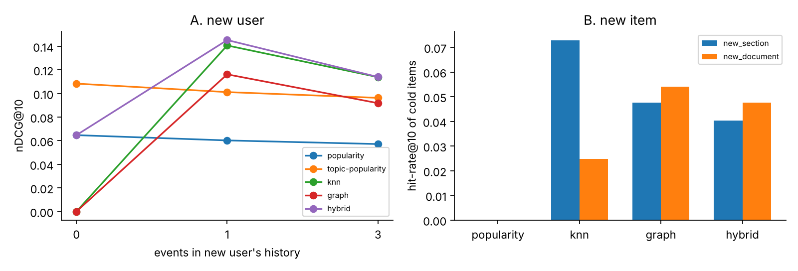

# Пояснення та cold start (ЛР16, результат 3)

## 1. Пояснення зі шляху в графі (C1)

**Конвеєр** (`reco/explain.py`, `scripts/make_explanations.py`): (1) для рекомендованого елемента береться найсильніший **шлях у графі** між ним і історією користувача (`GraphReco.explain_path`; якщо шляху в графі немає — kNN-шлях «найближчий елемент історії + косинус»; для cold start — «популярне за обраною темою»); (2) із фактів шляху заповнюється **шаблон** українською; (3) LLM лише **перефразовує** шаблон одним реченням і не має права додавати сутності, назви чи числа (промпт `SYSTEM` у `reco/explain.py`); (4) автоматична перевірка приймає текст, лише якщо він пройшов контроль; інакше показується шаблон.

Виконано для 20 користувачів × 5 рекомендацій = 100 пояснень (`eval/explanations.json`); перефрази одержано офлайн-протоколом (сліпі субагенти claude-haiku-4-5, 93 унікальні промпти, див. `llm_log/`). Приклади 5 рекомендацій:

**1. користувач u000 (reader), тип шляху `entity`, джерело шляху: graph, шлях існує в графі: True, перевірка пройдена: True**

* шлях: `(rare_output#h037)-[:MENTIONS]->(:Entity {name:'annotation'})<-[:MENTIONS]-(rare_output#h035)`
* шаблон: Рекомендовано «rare_output#h035 · Pipeline overview > Mitochondrial analysis > GENMOD», бо ви читали «rare_output#h037 · Pipeline overview > Mitochondrial analysis > Annotating mob…», і обидва розділи згадують annotation (Concept).
* перефраз LLM: Розділ «rare_output#h035 · Pipeline overview > Mitochondrial analysis > GENMOD» рекомендовано, бо ви читали «rare_output#h037 · Pipeline overview > Mitochondrial analysis > Annotating mob…», і обидва розділи згадують annotation (Concept).

**2. користувач u000 (reader), тип шляху `next`, джерело шляху: graph, шлях існує в графі: True, перевірка пройдена: True**

* шлях: `(gatk_funco_refdiff#h009)-[:NEXT]-(gatk_funco_refdiff#h010)`
* шаблон: Рекомендовано «gatk_funco_refdiff#h010 · HumanG1Kv37»: це розділ, суміжний із прочитаним вами «gatk_funco_refdiff#h009 · HumanG1Kv37» у тому самому документі.
* перефраз LLM: Розділ «gatk_funco_refdiff#h010 · HumanG1Kv37» рекомендовано як суміжний із прочитаним вами розділом «gatk_funco_refdiff#h009 · HumanG1Kv37» у тому самому документі.

**3. користувач u002 (reader), тип шляху `doc`, джерело шляху: graph, шлях існує в графі: True, перевірка пройдена: True**

* шлях: `(sarek_vc_theory#h006)-[:IN_DOC]->(:Doc)<-[:IN_DOC]-(sarek_vc_theory#h001)`
* шаблон: Рекомендовано «sarek_vc_theory#h001 · Calling Variants on Sequencing Data > Alignment» з того самого документа, що й прочитаний вами «sarek_vc_theory#h006 · Calling Variants on Sequencing Data > Calling Variants > Id…».
* перефраз LLM: Рекомендуємо розділ «sarek_vc_theory#h001 · Calling Variants on Sequencing Data > Alignment» з того самого документа, що й прочитаний вами розділ «sarek_vc_theory#h006 · Calling Variants on Sequencing Data > Calling Variants > Id…».

**4. користувач u005 (reader), тип шляху `similar`, джерело шляху: embedding, шлях існує в графі: True, перевірка пройдена: True**

* шлях: cosine(emb(rare_citations#h003), emb(rare_readme#h005)) = 0.844 (embeddings, не граф)
* шаблон: Рекомендовано «rare_readme#h005 · Citations»: він змістовно близький до прочитаного вами «rare_citations#h003 · Pipeline tools» (косинусна подібність 0.844).
* перефраз LLM: Рекомендовано розділ «rare_readme#h005 · Citations»: він змістовно близький до прочитаного вами «rare_citations#h003 · Pipeline tools» (косинусна подібність 0.844).

**5. користувач u001 (reader), тип шляху `entity`, джерело шляху: graph, шлях існує в графі: True, перевірка пройдена: True**

* шлях: `(bcftools_manual#h113)-[:MENTIONS]->(:Entity {name:'BCF'})<-[:MENTIONS]-(bcftools_manual#h109)`
* шаблон: Рекомендовано «bcftools_manual#h109 · Replace missing genotypes with 0|0 > bcftools query [OPTION…», бо ви читали «bcftools_manual#h113 · Replace missing genotypes with 0|0 > bcftools reheader [OPT…», і обидва розділи згадують BCF (Format).
* перефраз LLM: Розділ «bcftools_manual#h109 · Replace missing genotypes with 0|0 > bcftools query [OPTION…» рекомендовано, бо ви читали «bcftools_manual#h113 · Replace missing genotypes with 0|0 > bcftools reheader [OPT…», і обидва розділи згадують BCF (Format).

Важливо: це **постфактум-обґрунтування** зв'язку елементів, а не причинна атрибуція рішення моделі (гібрид ранжує за kNN+популярністю). Серед 100 рекомендацій 11 були реальними попаданнями в тестовому періоді.

## 2. Автоматична перевірка пояснень (C2)

`check(text, facts)` приймає пояснення, лише якщо: (а) кожна **сутність**, знайдена в тексті словниковим екстрактором, належить множині {сутність шляху, її тип, сутності з назв двох розділів шляху}; (б) кожна назва в «лапках» дорівнює назві кандидата або назві елемента-джерела; (в) кожне **число** є в фактах (косинус; цифри в назвах/сутностях); (г) названі кандидат, джерело, сутність (для `entity`) і значення косинуса (для `similar`). Додатково `verify_path` виконує Cypher-запит і підтверджує, що шлях справді існує (для `similar` — перераховує косинус).

**Частка пояснень, що відповідають шляху** (обчислена в `scripts/make_explanations.py`, `eval/explanations.json::summary`): шаблонів, що пройшли перевірку й мають реальний шлях, — 100 % (100/100); перефразів LLM, прийнятих перевіркою, — 100/100 = 100 %. Джерело шляху: граф 97, embeddings 3.

**Негативні контролі** (навмисно зіпсовані пояснення мають бути відхилені): додана стороння сутність — 100/100; неправдиве число — 100/100; підмінена назва — 100/100; прибране джерело — 100/100. Тести: `tests/test_explain.py`.

**Чесні застереження.** (1) 100 % — це не доказ відсутності галюцинацій: перевірка бачить лише сутності зі словника (106 + фрази) і числа; довільне нове твердження природною мовою без словникової сутності вона пропустила б. (2) Перевірка була **послаблена після перших запусків** (false positive: слово-тип «Annotation», цифри в назвах `hg19`/`VerifyBamID2`, регістр `Docker`), що зафіксовано в `claims/claims.csv` (c11); до послаблення проходило 81–94 %. (3) Перша версія міток розділів без id давала неоднозначні пояснення («прочитано той самий розділ»); мітки змінено на `id · заголовок` і перефрази згенеровано повторно (v1 збережено в `llm_log/v1/`).

## 3. Сценарії cold start (C3)

Реалізація: `reco/cold.py` (експерименти), `app/core.py` (`recommend_new_user`, `add_document`), тести `tests/test_cold.py`, `tests/test_app.py::test_new_user_and_new_item`.

**A. Новий користувач.** Історії немає; при реєстрації обрано роль і теми. Стратегії: `popularity` (глобальна), `topic-popularity` (найпопулярніше в обраних темах), `knn`/`graph`/`hybrid` на *k* перших прочитаних елементах (k = 0, 1, 3). При k = 0 персональні моделі нічого не знають — використовується популярність за темою (у демонстраторі — `POST /api/recommend/new-user`). Нові користувачі — усі користувачі з тестовими позитивами, чия тренувальна історія *відкинута*; обрані теми = дві теми з найбільшими латентними вподобаннями (**ідеалізація**: у реальності декларація шумніша).

**B. Новий документ / розділ.** Елемент не має жодної взаємодії і відсутній у графі й у лічильниках популярності до публікації; вставляється `ItemGraph.add_item` (вузол, IN_DOC, MENTIONS, NEXT до сусідів за порядком розділів), оцінюється за вмістом (граф: сутності/сусідство; kNN: embedding контенту). Дві підсценарії: 72 випадкові розділи відомих документів (`new_section`) і цілий новий документ (`new_document`, від 6 до 82 розділів за seed).

## 4. Метрики cold start (C4)

Середнє за 5 seed (`eval/cold_summary.json`, `docs/img/cold_start.png`).

**A. Новий користувач, nDCG@10 (P@5 / R@5 у JSON):**

| k елементів історії | popularity | topic-popularity | knn | graph | hybrid |
|---|---|---|---|---|---|
| 0 | 0.065 | **0.108** | 0 (немає історії) | 0 (немає історії) | 0.065 (= popularity) |
| 1 | 0.060 | 0.101 | **0.141** | 0.116 | 0.145 |
| 3 | 0.057 | 0.096 | 0.114 | 0.092 | 0.114 |

Висновок: за k = 0 обрані теми майже вдвічі краще за глобальну популярність (0.108 проти 0.065); достатньо **одного** прочитаного елемента, щоб персональні моделі обійшли topic-popularity (kNN 0.141, hybrid 0.145). Різницю між kNN і hybrid окремо на значущість не перевіряли (0.141 проти 0.145); hybrid-для-k=0 у демонстраторі слід замінити на topic-popularity (це робить `recommend_new_user`).

**B. Новий елемент, hit-rate@10** (частка пар «користувач, новий елемент, прочитаний у test», де елемент у топ-10; 630 пар для `new_section`, 144 для `new_document`):

| сценарій | popularity | knn | graph (після `add_item`) | hybrid (після `add_item`) |
|---|---|---|---|---|
| новий розділ відомого документа | 0.000 | **0.073** | 0.048 | 0.040 |
| новий документ | 0.000 | 0.025 | **0.054** | 0.048 |

До вставки граф і гібрид дають 0 для нових елементів (0.000); `add_item` дає ненульову видачу без жодної взаємодії. Популярність принципово не здатна рекомендувати новий елемент (0). Гібрид поступається kNN для нових розділів, бо його ваги налаштовані на елементи з історією взаємодій, а популярність нового елемента = 0. **Обмеження:** hit-rate малий (≤ 0.07), а для `new_document` спостережень мало і результат дуже нестабільний між seed (розмір нового документа 6…82 розділів); новий елемент у демонстраторі позначається `verified=False`, тож за замовчуванням не рекомендується, доки куратор його не схвалить.
