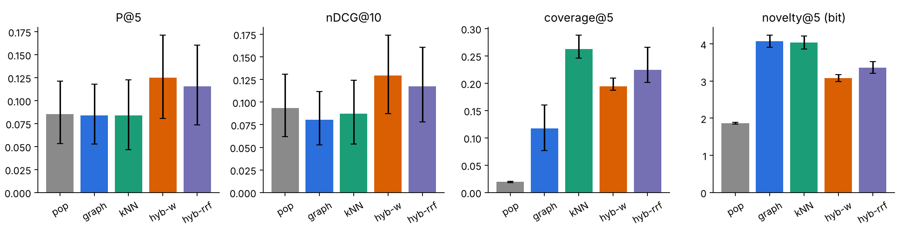
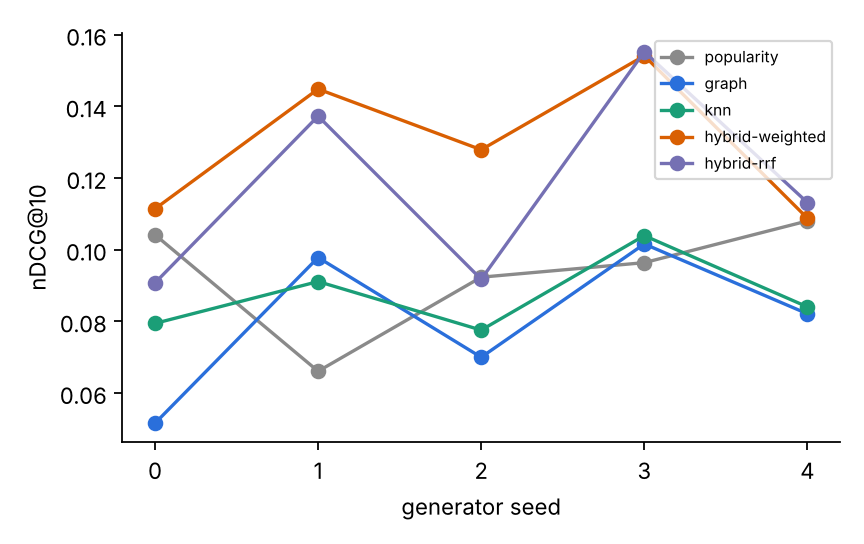

# Оцінка рекомендацій (ЛР16, результат 2)

## 1. Дані та часовий поділ без витоку майбутнього (C1)

**Дані.** Синтетичний журнал (`reco/synth.py`, детермінований за seed): 64 користувачі (36 reader / 18 analyst / 10 clinician), 84 дні, 3 683 події для seed 0 (2 441 тренувальних, 1 242 тестових). Модель користувача: Dirichlet-вподобання за 6 темами; сесія стартує з популярнісно-зваженого розділу теми, далі з імовірністю 0.4 переходить до наступного розділу документа, 0.2 — до випадкового розділу того ж документа, інакше — до нового популярного розділу теми; видимі лише розділи, дозволені ролі й верифіковані. Генератор **не використовує сутності/ребра графа** (лише документи й теми), щоб граф не мав вбудованої переваги, але структура «наступний розділ / той самий документ» у ньому закладена — це **зміщення на користь NEXT/doc-ребер**, яке треба враховувати.

**Поділ.** `CUTOFF = 63`: події з днем < 63 — **train**, ≥ 63 — **test** (`reco/eval.py::split`). Історія користувача = його train-події; позитиви = елементи, прочитані в test і **не** прочитані в train. Усе, що навчається на даних, бачить лише train: лічильники популярності (`Popularity(items, train)`), історія для всіх моделей, а також налаштування параметрів, яке проводиться у внутрішньому вікні (історія дні < 49 → позитиви дні 49…62), тож test не бере участі в підборі. Контент (тексти, embeddings, граф сутностей) не має часових міток пізніше за поділ. Користувачі без позитивів у test виключаються (59–63 із 64).

**Перевірки витоку (автоматичні):** `tests/test_reco.py::test_split_no_future_leakage` (усі історичні події < cutoff; позитиви ∩ історія = ∅), `test_popularity_uses_train_only` (елементи, прочитані лише в test, мають нульовий лічильник), `test_validation_window_precedes_test`.

## 2. Метрики та конфігурації (C2)

Метрики на користувача для топ-k: **precision@5**, **recall@5**, **nDCG@10**, **coverage@5** (частка каталогу з 674 доступних розділів, що трапилась у чиїйсь п'ятірці), **novelty@5** (середня самоінформація −log₂(частка користувачів, що читали елемент) за train). Конфігурації: popularity (базова лінія), graph, knn, hybrid-weighted, hybrid-rrf. Код: `reco/eval.py`; таблиця й графіки: `reco/report.py` → `eval/table.md`, `eval/summary.json`, `docs/img/eval_bars.png`, `docs/img/eval_seeds.png`.

## 3. Невизначеність (C3)

Повтор для **5 seed** генератора (різні користувачі й сесії) і **bootstrap-інтервали по користувачах** (1000 перевибірок, 95 %) у кожному seed. У таблиці: середнє за 5 seed ± стандартне відхилення між seed [середня межа 95 % bootstrap]. Для coverage bootstrap по користувачах зміщений донизу, тому там указано діапазон між seed.

| конфігурація | P@5 | R@5 | nDCG@10 | coverage@5 | novelty@5, біт |
|---|---|---|---|---|---|
| popularity | 0.085 ± 0.007 [0.053; 0.121] | 0.040 ± 0.012 [0.021; 0.064] | 0.093 ± 0.016 [0.062; 0.131] | 0.020 ± 0.001 [0.018; 0.021] | 1.864 ± 0.172 [1.839; 1.891] |
| graph | 0.084 ± 0.019 [0.053; 0.118] | 0.036 ± 0.009 [0.020; 0.056] | 0.081 ± 0.021 [0.053; 0.112] | 0.117 ± 0.030 [0.077; 0.160] | 4.073 ± 0.090 [3.915; 4.233] |
| knn | 0.084 ± 0.009 [0.047; 0.123] | 0.035 ± 0.005 [0.018; 0.055] | 0.087 ± 0.011 [0.053; 0.124] | 0.263 ± 0.016 [0.246; 0.288] | 4.042 ± 0.058 [3.866; 4.219] |
| **hybrid-weighted** | **0.125 ± 0.019 [0.081; 0.171]** | **0.054 ± 0.016 [0.032; 0.079]** | **0.129 ± 0.020 [0.087; 0.174]** | 0.195 ± 0.009 [0.187; 0.209] | 3.077 ± 0.362 [2.986; 3.168] |
| hybrid-rrf | 0.115 ± 0.034 [0.073; 0.160] | 0.049 ± 0.019 [0.029; 0.074] | 0.118 ± 0.028 [0.078; 0.160] | 0.225 ± 0.026 [0.202; 0.266] | 3.361 ± 0.239 [3.207; 3.522] |

**Парне порівняння nDCG@10** (hybrid-weighted мінус конфігурація, 300 користувачів = 5 seed × ~60, bootstrap 95 %): проти popularity +0.036 [0.011; 0.060]; проти knn +0.042 [0.028; 0.056]; проти graph +0.049 [0.029; 0.069] — інтервали не містять нуля.

**Абляція гібрида** (середнє nDCG@10 за 5 seed, ваги налаштовані на валідації): повний 0.129; без графа 0.133; без kNN 0.093; без популярності 0.089; рівні ваги (1, 1, 0.3) 0.095. Тобто **вклад дають kNN і популярність, вклад графа в ранжування не виявлено** (у seed 0–3 сітка вибрала `w_graph = 0`, у seed 4 — 0.5). Рівні ваги гірші за налаштовані, отже налаштування на валідації істотне. Дані: `eval/ablation.json`.

## 4. Вибір найкращої конфігурації (C4)

**Обрано hybrid-weighted (kNN + популярність, ваги з валідації).** Обґрунтування: найвищі P@5, R@5, nDCG@10 і парна перевага над усіма окремими підходами з інтервалами, що не перетинають 0; покриття ≈ 20 % проти 2 % у популярності. Компроміс: novelty (3.1 біт) нижча, ніж у graph/knn (≈ 4.0), бо популярність підтягує відомі розділи; RRF дає більше покриття й novelty ціною ~0.01 nDCG@10 (різниця в межах шуму між seed, ±0.03).

**Обмеження висновку.** (а) Дані синтетичні, тож абсолютні значення не переносяться на реальних користувачів; (б) абсолютна якість невисока (P@5 ≈ 0.12), бо позитиви — нові розділи, а вподобання розсіяні за темами; (в) різниця між окремими підходами (graph, knn, popularity) за nDCG@10 менша за міжseedову дисперсію — статистично підтверджена лише перевага гібрида; (г) 5 seed — мало для вузьких інтервалів; (д) граф не довів корисності для ранжування, його цінність у цій роботі — пояснення й cold start нових розділів (див. `docs/cold_start.md`); (е) метрики офлайнові, A/B-тесту немає.
